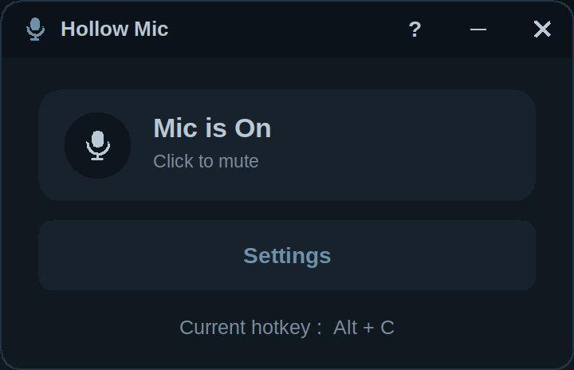
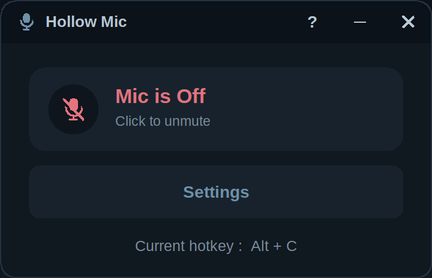
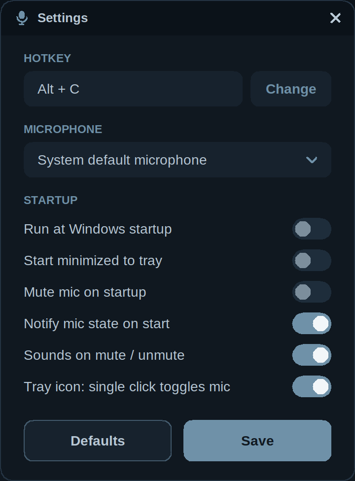
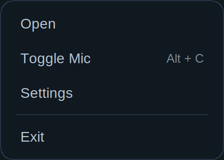

# Hollow Mic

**A tiny, system-wide microphone mute toggle for Windows.** Press a hotkey (default **Alt + C**) or click the tray icon and your microphone is muted or unmuted - in every app, including games and voice chat.

<p align="center">
  
  
</p>
<p align="center">
  
  
</p>


## Why

* **Light:** one ~350 KB exe, no installer, no runtime. It does nothing while idle except a 3-second state check.
* **Private:** fully offline - no network code, no telemetry, no updater.
* **Clean:** **never touches the registry.** Settings live in one `.ini` file; autostart is a normal shortcut in your Startup folder.
* **Game friendly:** the hotkey uses the standard `RegisterHotKey` API - no keyboard hook, no injection.
* **Pleasant:** custom dark UI, soft "hollow" mute / unmute sounds, no on-screen overlay.

## Features

* Global hotkey, fully configurable (default `Alt + C`)
* Mutes the real Windows capture device(s) - works with every application
* Microphone choice: **system default** (also mutes the default *communications* device, used by Discord / Teams), **all microphones**, or one specific device
* Tray icon: single click toggles the mic (optional), double click opens the window, right click opens a dark menu
* Optional: start with Windows, start minimized to tray, mute on startup, notification on start, mute / unmute sounds
* Stays in sync if you change the mute state elsewhere (checked every 3 seconds)
* Single instance: launching it again just brings up the window
* DPI aware, Windows 10 and 11 (64-bit)

## Install

No installer. Download `HollowMic.exe` from the [Releases](../../releases) page (or build it yourself, see below), put it anywhere and run it. It appears in the system tray (it may be inside the `^` overflow area on Windows 10 - drag it out to keep it visible).

To remove it: exit from the tray menu, turn off *Run at Windows startup* in Settings, delete the exe and the folder `%AppData%\hollow-mic`.

## Usage

| Action | Result |
|---|---|
| Hotkey (default `Alt + C`) | Toggle the microphone |
| Tray icon, single click | Toggle the microphone (can be turned off in Settings) |
| Tray icon, double click | Open the window |
| Tray icon, right click | Menu: Open / Toggle Mic / Settings / Exit |
| `Esc` in a window | Hide the window (the app keeps running) |
| Close / minimize buttons | Hide to the tray |

### Settings

| Setting | Description |
|---|---|
| Hotkey | Click **Change**, then press the new combination (`Esc` cancels). Every key except `F1-F24`, `Pause`, `Scroll Lock` and `Print Screen` needs `Ctrl`, `Alt` or `Shift` (otherwise you couldn't type it any more). The Windows key is not supported. If another program already owns the hotkey you are told and the old one is kept. |
| Microphone | System default (+ communications device), All microphones, or a specific device |
| Run at Windows startup | Creates / removes `Hollow Mic.lnk` in your Startup folder (`shell:startup`) |
| Start minimized to tray | Don't show the window at launch |
| Mute mic on startup | Mute as soon as the app starts |
| Notify mic state on start | Tray notification with the current state at launch |
| Sounds on mute / unmute | Play the soft hollow sounds |
| Tray icon: single click toggles mic | Otherwise a single click only opens the window |

## What it writes to your PC

| Where | What |
|---|---|
| `%AppData%\hollow-mic\settings.ini` | Your settings (created when you press *Save*) |
| `%AppData%\Microsoft\Windows\Start Menu\Programs\Startup\Hollow Mic.lnk` | Only while *Run at Windows startup* is on |
| Registry | **Nothing** |
| Network | **Nothing** |

Icons and sounds are generated or embedded in the exe, so no other files are created.

## Build from source

You need a **64-bit MinGW-w64** toolchain (built with GCC 13; any GCC with C++17 support should work; needs `make` and `windres`). The code is plain C++17 + Win32 + GDI+; there are no third-party libraries.

### Option A - Windows, no install: w64devkit (recommended)

1. Download the latest `w64devkit-x64-*.7z.exe` from <https://github.com/skeeto/w64devkit/releases> and extract it anywhere (it is portable).
2. Run `w64devkit.exe`. In the shell that opens, go to the project folder (drive `C:` becomes `/c`) and run `make`:
   ```sh
   cd /c/Users/<you>/Downloads/HollowMic
   make
   ```
3. `HollowMic.exe` appears in the project folder.

### Option B - Windows, MSYS2

```sh
pacman -S --needed mingw-w64-x86_64-gcc make
# open the "MSYS2 MinGW x64" shell, go to the project folder, then:
make
```

### Option C - Windows, `build.bat`

With a MinGW-w64 `bin` folder on your `PATH`, double-click `build.bat` or run it from a terminal. It runs the same commands as the Makefile.

### Option D - Linux / WSL / macOS (cross-compile)

```sh
sudo apt install mingw-w64 make          # Debian / Ubuntu
make CXX=x86_64-w64-mingw32-g++ WINDRES=x86_64-w64-mingw32-windres
```

### Verify the result

```bat
certutil -hashfile HollowMic.exe SHA256
```

The [GitHub Actions workflow](.github/workflows/build.yml) builds every push on a clean Linux runner and attaches `HollowMic.exe` plus its SHA-256 to each tagged release, so you can compare the public build with your own.

### Regenerate the assets (optional)

```sh
pip install pillow numpy scipy
python tools/make_icon.py        # res/app.ico
python tools/make_sounds.py      # writes ./out/ with every sound candidate; the shipped ones are "5-hollow"
```

The shipped sounds (`assets/sounds/hollow_on.wav`, `hollow_off.wav`) are embedded into the exe as resources by `res/app.rc`. To use your own, replace those two WAV files (16-bit PCM, short) and rebuild.

## Project layout

```
src/main.cpp     app lifecycle, hidden message window, tray, hotkey, mute logic, settings
src/ui.*         tiny custom-drawn widget engine (GDI+, double-buffered, animated)
src/draw.*       GDI+ helpers, microphone glyph, runtime tray icons
src/audio.*      Windows Core Audio: mute state and device list (IAudioEndpointVolume)
src/config.*     settings.ini, Startup shortcut, hotkey text
src/sound.*      plays the embedded sounds
src/lang.*       every UI string (English)
src/theme.h      colour palette ("Hollow - Phantom")
res/             icon, manifest (DPI aware), version info, embedded sounds
assets/sounds/   hollow_on.wav / hollow_off.wav
tools/           icon and sound generators
.github/         CI build
```

## Antivirus warnings

The exe is **not code-signed**, and small unsigned programs that register a global hotkey and a startup shortcut are sometimes flagged by heuristic ("machine learning") detections such as *Wacatac.B!ml*. That is a false positive, but you shouldn't take anyone's word for it: read the source, build it yourself, and compare hashes. If your antivirus flags a build, you can report it as a false positive (Microsoft: *Security Intelligence -> Submit a file*).

## Status

Version 1.0. The UI, settings, tray, hotkey capture, single-instance and autostart logic were exercised under Wine on Linux. Muting itself uses the documented Core Audio API, but because it needs a real audio device it has to be confirmed on real Windows hardware - please [open an issue](../../issues) if something doesn't work on your setup (include your Windows version and what the *Microphone* setting was).

Deliberately **not** included: on-screen overlay, auto-update, telemetry.

## License

[MIT](LICENSE). The two sounds and the icon are original works released under the same license.
